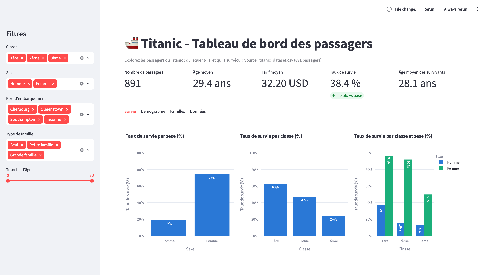
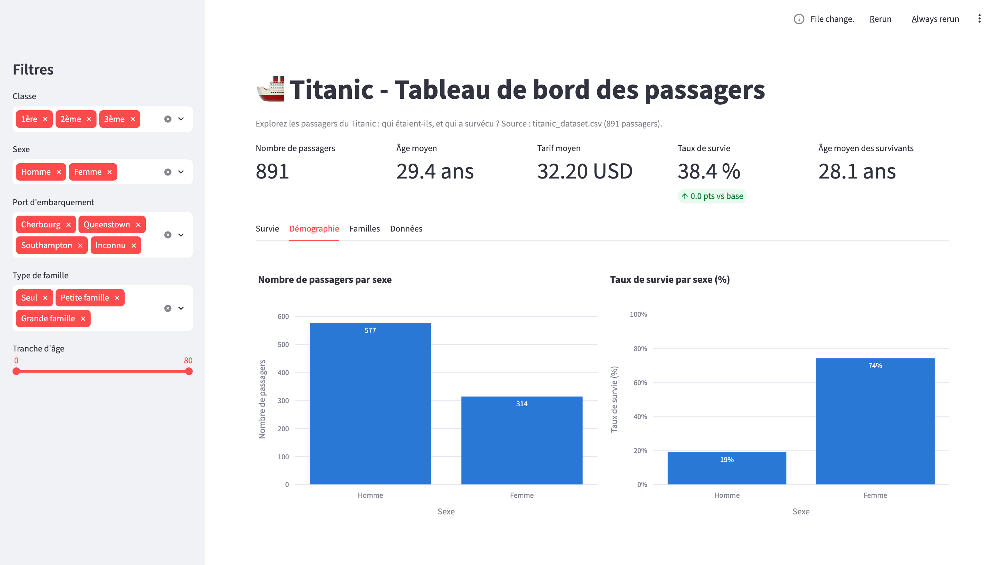
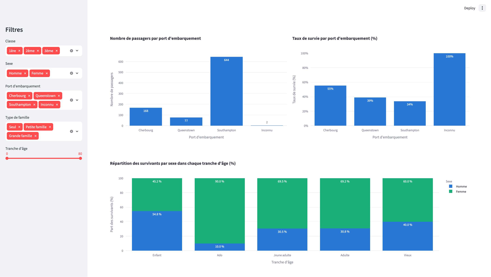
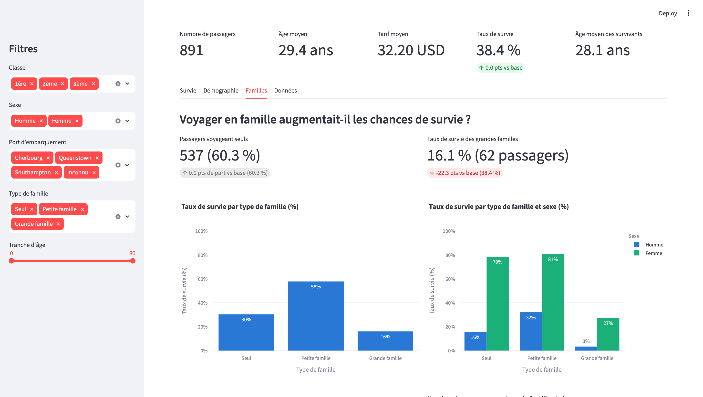
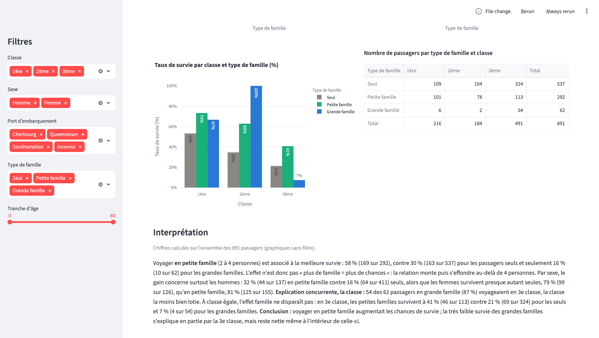
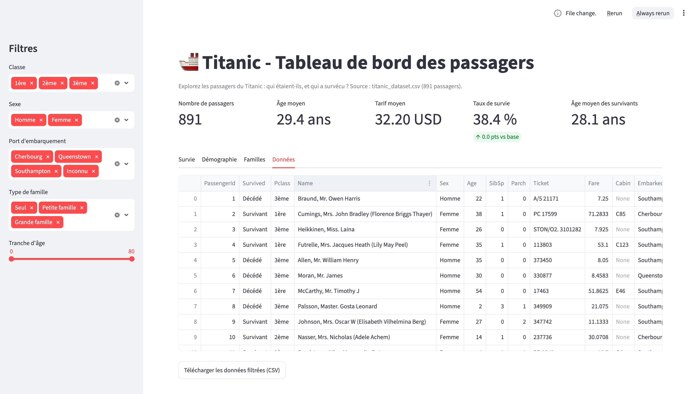

# Titanic vu par les familles — application Streamlit

**Question :** voyager en famille augmentait-il les chances de survie ?

## Lancement

```bash
pip install streamlit pandas plotly
streamlit run app.py
```

Le fichier `titanic_dataset.csv` (891 passagers, 12 colonnes) doit se trouver dans le même dossier que `app.py`.

## Contenu

- **Barre latérale :** filtres classe, sexe, port, type de famille (nouveau) et tranche d'âge. Ils s'appliquent à tous les onglets. Si une sélection est vide, un message s'affiche à la place des graphiques.
- **Survie / Démographie / Données :** les onglets du tableau de bord du cours.
- **Familles (nouveau) :** deux indicateurs (passagers seuls, survie des grandes familles, avec l'écart par rapport à la base), le taux de survie par type de famille (seul, puis par sexe et par classe), un tableau croisé type de famille × classe avec totaux, l'interprétation et la section « Limites des données ».

Tous les taux passent par la fonction `taux_par(data, colonnes)`, qui renvoie le taux, le nombre de survivants et l'effectif.

## Préparation des données

- `taille_famille` = SibSp + Parch + 1, et `type_famille` : Seul (1), Petite famille (2 à 4), Grande famille (5 et plus).
- `titre` : le mot entre la virgule et le point de `Name`. Mlle et Ms sont regroupés avec Miss, Mme avec Mrs, et tous les autres titres sont classés « Autre ».
- **177 âges imputés sur 891 (19,9 %)** avec la médiane du titre (Master 3,5 ans, Miss 21, Mr 30, Mrs 35, Autre 48,5). La colonne `age_impute` signale les lignes modifiées.

**Pourquoi la médiane par titre ?** Le titre renseigne sur l'âge : « Master » désigne un garçon, « Miss » le plus souvent une jeune femme non mariée, « Mrs » une femme mariée. Avec la médiane globale (28 ans), un garçon de 4 ans recevrait le même âge qu'un adulte, ce qui fausserait les analyses par âge. La médiane par titre donne une valeur plus réaliste, sans être tirée par les quelques passagers très âgés.

## Captures d'écran

### Survie



### Démographie




### Familles




### Données


